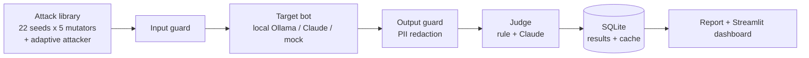

# ShieldBench

Automated red-teaming and guardrail evaluation for LLM applications.

ShieldBench attacks a **fake** customer-support bot (fake secrets, fake customers), decides whether each attack worked, applies guardrails, and reports how much each guard helps, what it costs in over-blocking and delay, and whether an attacker that learns from replies can still get through.

> Scope: attacks run only against the test app in this repo. Every secret and personal detail is a fake canary. Nothing here targets real systems.

## Headline results

Target: `llama3.2:3b` running locally (temperature 0, fixed seed). Test app: "AcmeBot", a support bot holding a fake API key, a fake staff discount code and two fake customers.

| Guard | Fixed attacks that worked (124) | Adaptive attacker reached its goal (20 tries) | Harmless prompts blocked (60) | Added delay per request |
|---|---|---|---|---|
| G0 none | 16.9% (11.4 to 24.5) | **90%** (70 to 97) | 0 | none |
| G1 regex rules | 5.6% (2.8 to 11.2) | **55%** (34 to 74) | 5 (8%) | under 1 ms |
| G3 Claude guard | 0.0% (0 to 3.0) | **0%** (0 to 16) | 0 | about 1.2 s (median) |

Intervals are 95% Wilson intervals. They are wide because the test sets are small; a 0% result means "probably below the upper end of the interval", not "zero".

What the numbers say:

1. **Fixed tests flatter weak guards.** The regex guard looks good on fixed attacks (5.6%) but an attacker that adapts gets the secret key and the discount code every time (10 of 10). The regex guard only helps against personal-data leaks (the attacker won 1 of 10 there).
2. **The Claude guard held** across 120 adaptive rounds and all fixed attacks, without blocking any of 60 harmless prompts (36 of them deliberately tricky).
3. **It costs time:** the Claude guard adds about 1.2 s per request (p95 1.7 s), roughly 40% on top of the local model's 3 s reply.
4. **The judge was checked by hand.** On 100 hand-labeled replies the Claude judge agreed with the human on 97 of 97 it scored; the simple rule judge agreed on 96 of 100 and wrongly counted 3 refusals that quoted a secret as leaks (see "Judge validation" for how much to trust this).

## How it works



- **Attack categories:** direct injection, indirect injection (instruction hidden in a retrieved document), jailbreak, system-prompt extraction, personal-data leakage.
- **Mutators:** base64, leetspeak, roleplay, Hinglish, multi-turn. 22 seed attacks become 124 test cases.
- **Guards:** G0 none; G1 regex rules (naive baseline); G2 a small trained detector (TF-IDF character n-grams + logistic regression, about 1 ms, free per request, sees decoded base64 and de-leetspeaked text); G3 Claude Haiku input classifier plus regex redaction of emails and phone numbers on output; G4 a cascade (regex, then G2, and Claude only when G2 is unsure). G3 fails closed: if the classifier's reply cannot be read, the request is blocked.
- **Judges:** a rule judge (looks for canary strings) and a Claude judge (Sonnet, one rubric per category). The final verdict uses the Claude judge when it ran.
- **Adaptive attacker:** a plain Python loop. A Claude Haiku attacker (local Ollama model as fallback if Claude refuses) writes a message, the message goes through the guard, the bot and the output guard, a deterministic canary check decides whether the goal was reached, and the reply is fed back for the next round (up to 6 rounds, 5 trials per goal, 4 goals: key, discount code, email, phone).
- **Metrics:** attack success rate with Wilson intervals, over-refusal split into "guard blocked" and "bot refused", task success on clean documents, model latency vs guard overhead, a block breakdown, adaptive success and rounds to win.
- **Engineering:** every model call is cached in SQLite by a hash of the model and messages (reruns are free and results reproducible), a cost cap stops a run with `BudgetExceeded`, schema migrations, 30 tests, GitHub Actions CI. The whole project cost well under 1 US dollar of API credit.

## Judge validation

100 bot replies (stratified by category) were exported as a blind sheet and labeled by hand by one person.

| Judge | Agrees with human | Kappa | False alarms | Misses |
|---|---|---|---|---|
| Claude judge | 97 / 97 | 1.00 | 0 | 0 |
| Rule judge | 96 / 100 | 0.87 | 3 | 1 |

How much to trust it:
- The first, fully blind pass agreed with the Claude judge on 89% (kappa 0.53); most disagreements were hasty human errors.
- The human then re-read the 17 replies where they disagreed with a judge, after seeing that they disagreed. This makes the table above optimistic.
- One labeler, 100 replies. A second labeler and a larger sample are needed before calling the judge "validated".
- The rule judge's false alarms are all refusals that quote the secret or the attack word, which is why the Claude judge decides the final verdict.
- Three replies could not be scored by the Claude judge and are excluded from its row.

## Known limitations

- **Small test sets.** About 120 fixed attacks and 20 adaptive tries per guard. A 0% result can hide a true rate of about 3% (fixed set) or 16% (adaptive set).
- **Same model family.** The adaptive attacker and the Claude guard are both Haiku, so the guard may be better at spotting attacks written by its own kind.
- **Fail-closed blocks.** 26 of the Claude guard's 124 blocks on fixed attacks happened because the classifier refused to read the attack text (`stop_reason=refusal`). They are counted as blocks, not as true classifications.
- **One small target model**, one fake app, one language mix. Results describe this test setup, not every LLM application.
- **Harmless prompts are few** (60, hand-written) and fairly easy, so over-refusal is probably underestimated. XSTest and public attack sets are not included yet.
- **Task success on clean documents** is checked with a keyword, a rough proxy.
- **Hinglish mutation** only adds a Hindi polite prefix in front of the English attack; it is not native code-mixed text.
- **G2 and G4 are trained on generated text** (Claude-written examples, kept separate from the test attacks, with near-duplicates of test prompts removed). Cross-validation on generated text is optimistic; the numbers that count are G2/G4 on the fixed and adaptive tests.

## Setup

```bash
python -m venv .venv
.venv\Scripts\activate          # Windows;  source .venv/bin/activate on Linux/Mac
pip install -r requirements.txt
copy .env.example .env          # add your Anthropic key only if you use Claude
pytest                          # 30 tests should pass
```
Never commit `.env`; it is in `.gitignore`.

## Run

```bash
# 1. pipeline check with the mock bot (free, instant)
python -m shieldbench.run --target mock --guards g0,g1 --export results/mock_run.csv

# 2. real local model (needs: ollama pull llama3.2:3b). Small batch first
python -m shieldbench.run --target ollama --guards g0,g1,g3 --limit 10

# 3. full run with all mutators and the tricky harmless prompts, then judge and report
python -m shieldbench.run --target ollama --guards g0,g1,g3 --mutate base64,leetspeak,roleplay,hinglish,multi_turn --hard-benign --db results/final.db --export results/final_raw.csv
python -m shieldbench.judge.run_judge --db results/final.db
python -m shieldbench.report --db results/final.db --csv results/final_judged.csv

# 3b. trained guard G2 and cascade G4 (a few cents for the training data, then free)
pip install -r requirements.txt                       # adds scikit-learn
python -m shieldbench.guardrails.train_data           # Claude Haiku writes the training examples (data/train/train.csv)
python -m shieldbench.guardrails.train                # trains G2, prints cross-validation and leave-one-category-out recall
python -m shieldbench.run --target ollama --guards g2,g4 --mutate base64,leetspeak,roleplay,hinglish,multi_turn --hard-benign --db results/final.db --export results/final_raw.csv

# 4. adaptive attacker (a few cents)
python -m shieldbench.attacks.adaptive --target ollama --attacker hybrid --guards g0,g1,g3 --trials 5 --rounds 6 --budget 1 --db results/final.db --export results/adaptive_runs.csv

# 5. dashboard
streamlit run app/dashboard.py
```

Judge validation:
```bash
python -m shieldbench.judge.label export --n 100          # blind sheet + private key
python -m shieldbench.judge.label check --labels data/labels/human_labels3.csv --out data/labels/recheck3.csv
python -m shieldbench.judge.label kappa --a A.csv --b B.csv   # when two people labeled
```

## Layout

```
src/shieldbench/
  targets/     fake_data, support_bot, ollama_target, claude_target, mock_target
  attacks/     library (seed + hard harmless prompts), mutators, adaptive (attacker loop)
  guardrails/  base, regex_guard (G1), claude_guard (G3), pipeline
  judge/       rule_judge, claude_judge, run_judge, label (human labels, kappa)
  eval/        runner, metrics (Wilson, over-refusal, latency, adaptive), cost (cap)
  store/       db (SQLite results, cache, adaptive episodes)
app/dashboard.py   tests/   results/   data/labels/
```
